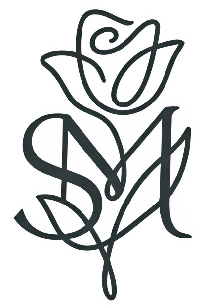
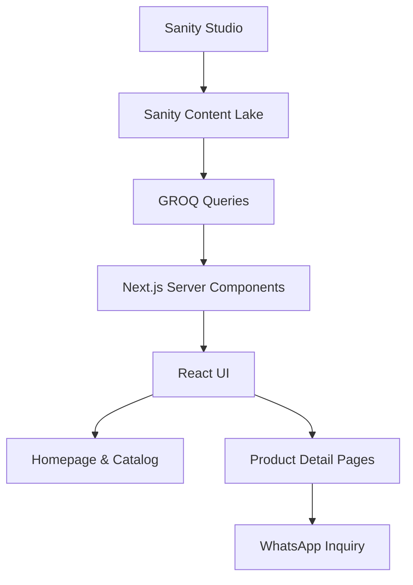

<div align="center">



# STEPHANY MANZANO

### Home Collection

An editorial digital catalog for a handcrafted home decor brand.

Discovering the beauty of handmade objects through a refined,
content-driven web experience.

**Next.js · React · TypeScript · Tailwind CSS · Sanity CMS**

[**Live Website**](https://stephanymanzano.com) ·
[**Developer Portfolio**](https://jonathanmoralesdev.com)

</div>

---

## Overview

**Stephany Manzano Home Collection** is a digital product catalog
developed for a brand specializing in handcrafted decorative pieces,
artistic candles, and sculptural home accessories.

The application combines an editorial visual identity with a
content management system that allows product information,
collections, imagery, and curated homepage sections to be
managed independently from the frontend.

Rather than implementing a traditional e-commerce checkout,
the experience focuses on **product discovery, brand storytelling,
and direct customer communication through WhatsApp**.

The project was developed using **Next.js App Router**,
**TypeScript**, **Tailwind CSS**, and **Sanity CMS**.

---

## Visual Identity

The interface follows an editorial design approach inspired
by contemporary product photography, handcrafted materials,
and minimalist digital experiences.

Its visual system emphasizes generous spacing, refined
typography, product imagery, and subtle interactions.

<div align="center">


</div>

### Design System

| Element              | Specification          |
| -------------------- | ---------------------- |
| Background           | Cream — `#F9F7F2`      |
| Primary Accent       | Soft Pink — `#E5B6BD`  |
| Typography Color     | Charcoal — `#383838`   |
| Interactive Accent   | Terracotta — `#BC5D58` |
| Secondary Accent     | Gold — `#C5A065`       |
| Brand Typography     | Tenor Sans             |
| Editorial Typography | Lora                   |
| Interface Typography | Montserrat             |

The design system is implemented through Tailwind CSS v4
theme tokens and locally configured font variables.

---

## Key Features

### Dynamic Product Catalog

Products are retrieved from Sanity CMS and presented through
responsive layouts.

Each product can contain its name, description, images,
materials, dimensions, and additional editorial content.

### Curated Homepage

The homepage uses a content-driven curation system.

Administrators can configure product showcases through
Sanity Studio by selecting categories and the products
that should appear within each carousel.

### Category & Collection Navigation

Products are organized into categories and collections.

Dynamic routes allow visitors to explore the catalog
through structured product groupings.

### Product Detail Pages

Each product has a dedicated page featuring:

- Product information and imagery.
- Interactive image gallery.
- Category and collection references.
- Materials and dimensions.
- Editorial descriptions and rich-text storytelling.
- Direct WhatsApp inquiry.

### Responsive Navigation

The application includes responsive navigation for
desktop, tablet, and mobile devices.

### Subtle Motion & Interactions

Framer Motion is used to introduce visual transitions
and entrance animations that complement the editorial
presentation.

### Direct Customer Communication

WhatsApp links provide a direct communication channel
between visitors and the brand.

Product pages generate contextual inquiry messages
using the selected product information.

---

## Technology Stack

| Category           | Technologies                    |
| ------------------ | ------------------------------- |
| Framework          | Next.js 16 — App Router         |
| UI Library         | React 19                        |
| Language           | TypeScript                      |
| Styling            | Tailwind CSS v4                 |
| Animation          | Framer Motion                   |
| Content Management | Sanity CMS / Sanity Studio      |
| Data Queries       | GROQ                            |
| Rich Text          | Portable Text                   |
| Image Management   | Next.js Image, Sanity Image URL |
| Icons              | Lucide React                    |
| Code Quality       | ESLint                          |
| Deployment         | Vercel                          |

---

## Project Architecture

The repository contains two separate applications:

1. **Next.js application:** Responsible for rendering
   the website and retrieving catalog information.
2. **Sanity Studio:** Responsible for managing the
   brand's structured content.

Both applications have their own dependencies and
configuration.

```text
smhc-web/
│
├── public/
│   ├── hero-smhc.webp
│   └── smhc_logo_nobg.png
│
├── sanity/
│   ├── schemaTypes/
│   │   ├── category.ts
│   │   ├── collection.ts
│   │   ├── homeCurator.ts
│   │   ├── product.ts
│   │   └── index.ts
│   │
│   ├── sanity.config.ts
│   ├── sanity.cli.ts
│   └── package.json
│
├── src/
│   ├── app/
│   │   ├── coleccion/
│   │   │   └── [slug]/
│   │   │       └── page.tsx
│   │   │
│   │   ├── contacto/
│   │   │   └── page.tsx
│   │   │
│   │   ├── nosotros/
│   │   │   └── page.tsx
│   │   │
│   │   ├── product/
│   │   │   └── [slug]/
│   │   │       └── page.tsx
│   │   │
│   │   ├── globals.css
│   │   ├── layout.tsx
│   │   └── page.tsx
│   │
│   ├── components/
│   │   ├── layout/
│   │   ├── motion/
│   │   ├── product/
│   │   └── ui/
│   │
│   └── lib/
│       └── sanity.ts
│
├── next.config.ts
├── tsconfig.json
└── package.json
```

### Architecture Responsibilities

**`src/app/`**

Contains the application's routes, layouts, and
page-level data retrieval.

Next.js App Router is used to organize the website
around its principal sections and dynamic catalog pages.

**`src/components/layout/`**

Contains shared layout components, including navigation,
footer, and content containers.

**`src/components/product/`**

Contains product-specific interface components,
including the interactive image gallery.

**`src/components/motion/`**

Provides reusable animation components implemented
with Framer Motion.

**`src/components/ui/`**

Contains reusable interface elements such as
carousels and contact buttons.

**`src/lib/sanity.ts`**

Centralizes the Sanity client configuration and
image URL generation utility.

**`sanity/schemaTypes/`**

Defines the content models used by Sanity Studio.

---

## Content Architecture

Sanity CMS manages the structured content consumed
by the Next.js application.

The content model includes four document types.

### Product

Represents an individual handcrafted piece.

The schema supports:

- Name and URL slug.
- Category and collection references.
- Main image and image gallery.
- Short description and product purpose.
- Rich-text storytelling.
- Materials and dimensions.
- Availability information.
- WhatsApp inquiry message.

### Category

Represents a primary catalog classification.

Categories contain identifying information and
URL slugs used for navigation.

### Collection

Groups products into named collections.

Each collection references a parent category,
supporting the organization of the product catalog.

### Home Curator

Provides a content management interface for
configuring the homepage's product showcases.

It allows editors to select categories and
specific products for each showcase.

This keeps homepage product selection independent
from the presentation components.

---

## Data Flow

The application retrieves structured content from
Sanity and renders it through Next.js.



### How It Works

1. Product content is created and managed in Sanity Studio.
2. Sanity stores the structured documents and image references.
3. Next.js retrieves the required information using GROQ queries.
4. Server Components render catalog and product content.
5. Client Components provide interactive functionality
   such as navigation, carousels, and galleries.
6. Visitors explore the catalog and can initiate
   product-specific conversations through WhatsApp.

The catalog queries currently use a 60-second
revalidation configuration for content retrieval.

---

## Engineering Decisions

### Next.js App Router

Next.js provides a file-based routing system and
supports Server Components for retrieving and
rendering catalog content.

Dynamic routes are used for category and product
detail pages.

### Sanity as a Headless CMS

Sanity separates content management from
the frontend presentation layer.

This allows the brand to maintain product data,
images, categories, collections, and homepage
showcases without modifying React components.

### GROQ for Content Retrieval

GROQ queries retrieve structured documents
and resolve references between related content.

This supports the catalog's category,
collection, and product relationships.

### Server and Client Component Separation

Page-level content retrieval is handled through
Next.js Server Components.

Client Components are used where browser
interactivity and React state are required.

### Tailwind CSS v4

Tailwind CSS provides utility-based styling,
while theme tokens help maintain consistency
across the interface.

### Framer Motion

Framer Motion provides reusable entrance animations
that support the project's visual presentation.

### WhatsApp-Based Conversion

The application uses direct messaging rather
than a traditional shopping cart and payment flow.

This approach reflects the brand's current
personalized ordering experience.

---

## Getting Started

### Prerequisites

- Node.js and npm compatible with the project dependencies.
- A Sanity project and dataset.
- Access to the Sanity project for content management.

The repository contains separate dependency manifests
for the Next.js application and Sanity Studio.

### 1. Clone the Repository

```bash
git clone https://github.com/0sayo0/smhc-web.git
cd smhc-web
```

### 2. Install Website Dependencies

```bash
npm ci
```

### 3. Configure Environment Variables

Create a `.env.local` file in the project root.

Configure the following variables:

```env
NEXT_PUBLIC_SANITY_PROJECT_ID=your_project_id
NEXT_PUBLIC_SANITY_DATASET=production
NEXT_PUBLIC_SANITY_API_VERSION=2024-01-01
```

Replace the project ID, dataset, and API version
with the values appropriate for your Sanity project.

The Sanity Studio configuration also references
its project ID and dataset in its configuration files.

If using another Sanity project, update the Studio
configuration accordingly.

### 4. Start the Website

```bash
npm run dev
```

Open the local development URL displayed by Next.js.

### 5. Install Sanity Studio Dependencies

Open another terminal:

```bash
cd sanity
npm ci
```

### 6. Start Sanity Studio

```bash
npm run dev
```

Open the local Studio URL displayed in the terminal.

Content editing requires appropriate permissions
for the configured Sanity project.

---

## Available Scripts

### Next.js Application

Run these commands from the repository root.

| Command         | Description                          |
| --------------- | ------------------------------------ |
| `npm run dev`   | Start the Next.js development server |
| `npm run build` | Create a production build            |
| `npm run start` | Start the production server          |
| `npm run lint`  | Run ESLint                           |

### Sanity Studio

Run these commands from the `sanity/` directory.

| Command                  | Description                   |
| ------------------------ | ----------------------------- |
| `npm run dev`            | Start Sanity Studio locally   |
| `npm run build`          | Build Sanity Studio           |
| `npm run deploy`         | Deploy Sanity Studio          |
| `npm run deploy-graphql` | Deploy the Sanity GraphQL API |

---

## Deployment

The website is available at:

**[stephanymanzano.com](https://stephanymanzano.com)**

The application is built with Next.js and deployed
through Vercel.

Sanity operates as an independent content platform,
providing structured data and image assets to
the frontend application.

---

## Project Context

This project was developed for
**Stephany Manzano Home Collection**, a brand focused
on handcrafted decorative products.

Its purpose is to provide a digital environment
where product presentation, visual identity,
and content management work together.

The application demonstrates the integration
of a modern React framework with a headless CMS,
dynamic content modeling, and an editorial user interface.

---

## Developer

**Jonathan Saúl Morales Espinosa**

Full Stack Software Developer

[Portfolio](https://jonathanmoralesdev.com) ·
[GitHub](https://github.com/0sayo0) ·
[LinkedIn](https://www.linkedin.com/in/jonathan-morales-dev/)

---

<div align="center">

**STEPHANY MANZANO HOME COLLECTION**

_Handcrafted objects. Thoughtful design. Digital craftsmanship._

[**Explore the Collection**](https://stephanymanzano.com)

</div>
